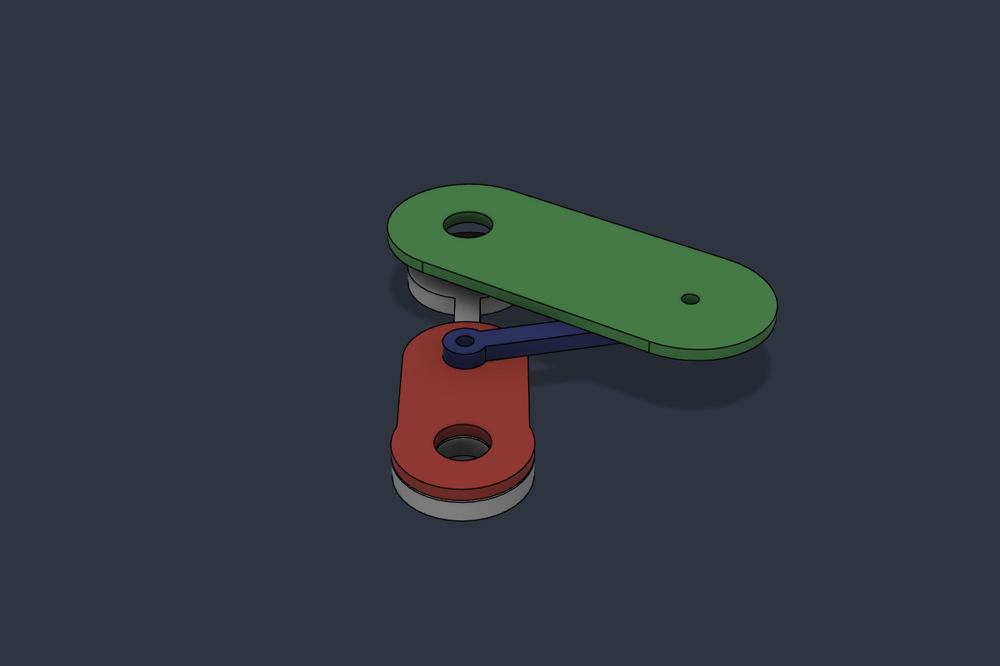
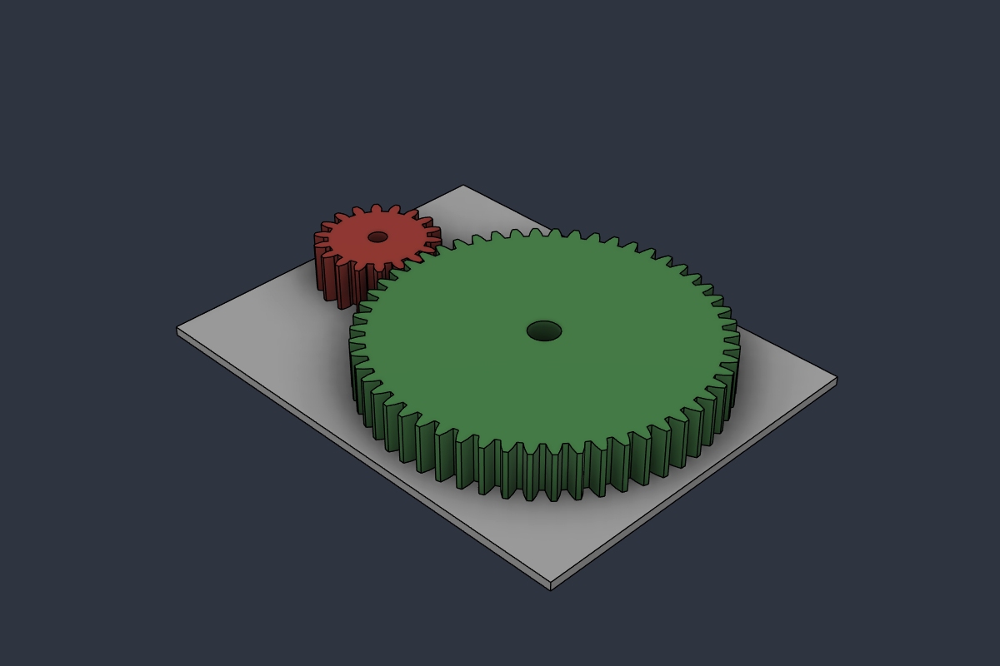
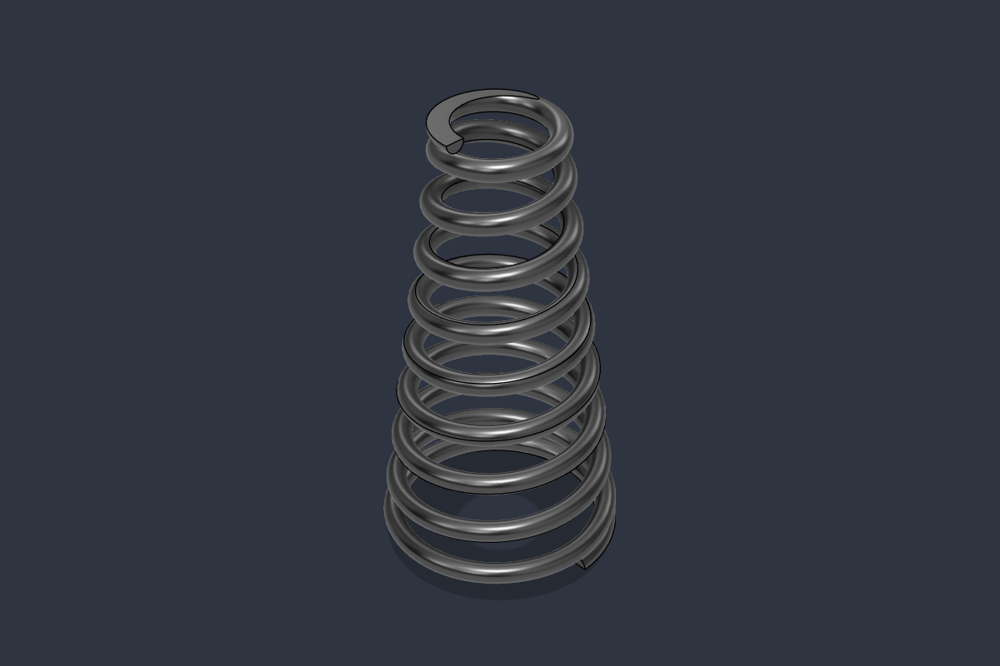
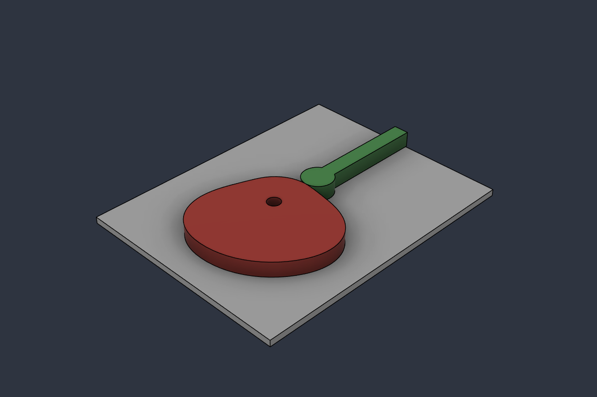
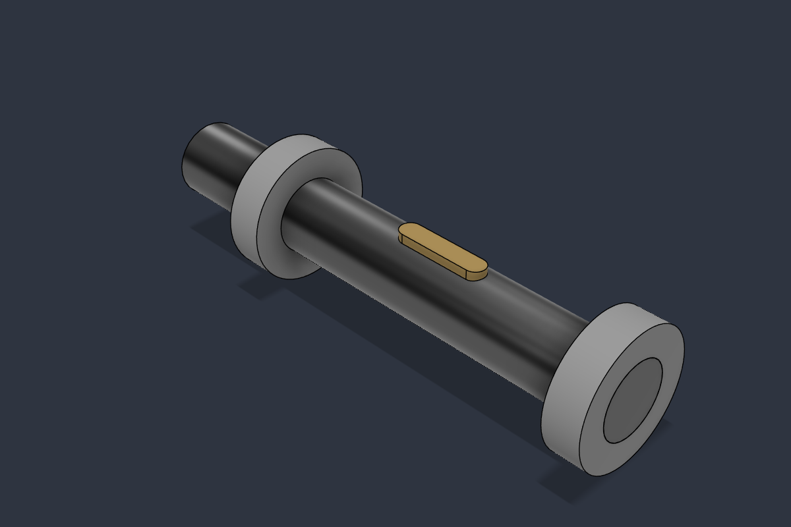
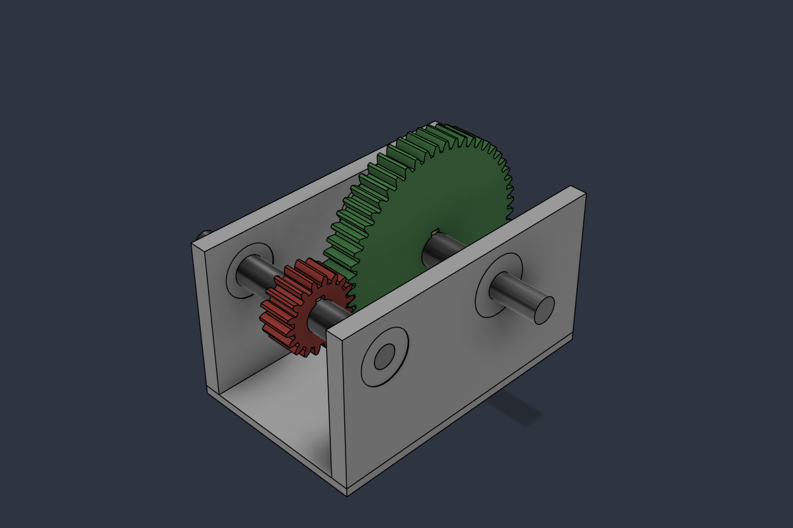
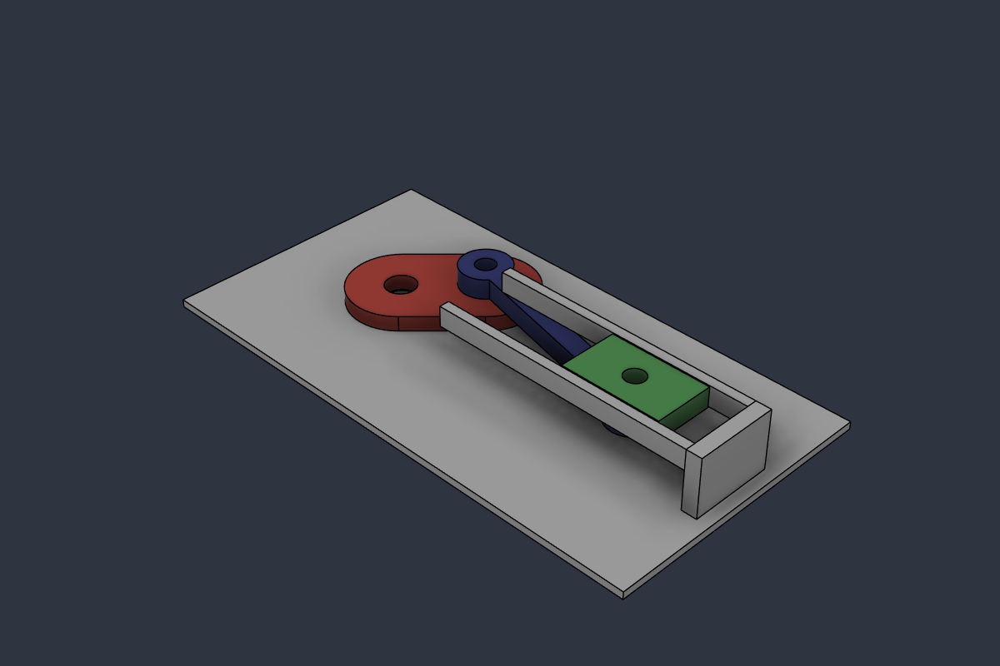
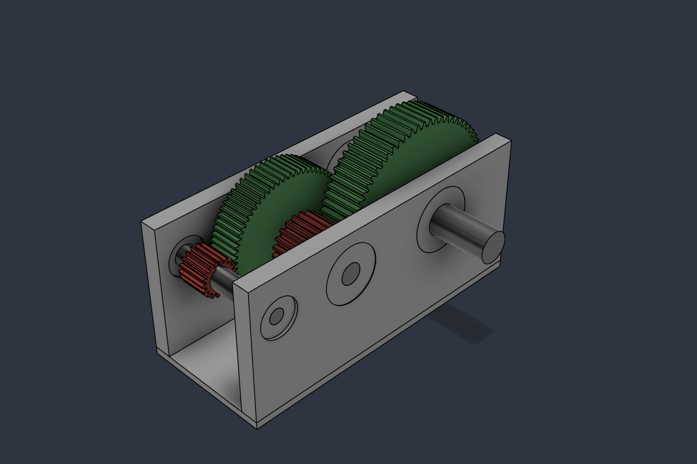
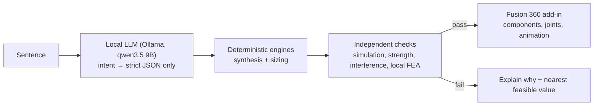

# Mechanism Assistant: solver-grounded mechanism design in Fusion 360

Describe a machine element in plain language and get a **sized, checked and drawn** Fusion 360 assembly
that you can rotate. Everything runs locally: a local LLM (Ollama), deterministic Python engines and local FEA.

> *"turn a 4 cm arm 45° and the other arm turns 120°, PETG, 2 kg"*
> → Freudenstein function generator, strength and interference checks → four-bar in Fusion with joint limits
>
> *"1.5 kW 1450 rpm motor, 1:4 gearbox"*
> → gear pair, both shafts, bearings, keys and housing sized together → a reducer you can turn in Fusion

Sentences can be written in English or Turkish.

| Four-bar (crank-rocker / rocker-rocker) | Spur gear pair | Conical compression spring |
|---|---|---|
|  |  |  |
| **Disk cam + roller follower** | **Two-bearing shaft (fatigue)** | **Single-stage reducer (system)** |
|  |  |  |
| **Slider-crank (piston)** | **Two-stage reducer (system)** | |
|  |  | |

## Core rule: the LLM never produces a number

Existing "LLM → CAD" tools let the model write geometry code directly. The results look plausible but nothing
checks them. This project splits the work into three parts:



* **LLM:** It only fills a JSON schema (strict output, two stages: a router picks the module, then a short
  module-specific extractor fills its fields). Missing values are reported, never guessed. A regex backstop
  catches input angles and speeds the model misses. The evaluation set is `tools/llm_eval.py` (43/43, incl. 11
  edits of an existing design).
* **Edits:** once a design is on screen, "make the crank 40 mm", "use aluminium" or "krankı 5 mm uzat" change it.
  The LLM lists the changes; every amount must appear in the message, so "a bit longer" gets a question, not a guess.
* **Engines:** Textbook methods (Norton, Shigley) in plain Python. Every result is re-verified by a method that
  is *independent* of the one that produced it. For example, synthesis is checked by position-loop simulation.
* **Fusion:** The add-in only draws what the engines decided. It reuses one tagged document instead of opening
  new tabs.

## Modules

| Module | Design method | Checks |
|---|---|---|
| Four-bar, full rotation | Crank-rocker Q = 1 (c = a / sin(ψ/2)), quick-return Q > 1 (Norton) | Grashof, transmission angle 40–140° (synthesis targets 45°), branch consistency, simulated swing and Q |
| Four-bar, limited input | Freudenstein function generator, 3 Chebyshev precision points | Structural error ≤ 1°, transmission angle over the range, Fusion joint limits |
| Slider-crank (piston) | Stroke given; crank from the exact stroke formula (with offset), rod the shortest whole mm with b/a ≥ 3 and rod angle ≤ 20° | Simulated stroke, rod ratio, rod angle (side load), quick-return Q with offset; crank torque by virtual work T = F·|dx/dθ| (tested against the rod-force moment); crank and rod sized like the four-bar links; piston speed / acceleration; in Fusion the solver's piston position equals x(θ) at 36 angles |
| Link sizing | Per-link width/thickness for load and material (PLA, PETG, Al 6061, steel), local bosses D = 2.5d | Euler buckling, net section, bending, pin shear and bearing, Roark K_t, L/200 deflection incl. FEA-calibrated hub compliance, steel shaft torsion, layer interference ≥ 1 mm |
| Spur gears | Lewis bending (Shigley Y table, Barth K_v), involute teeth | Contact ratio ≥ 1.2, undercut z ≥ 17, Hertz contact stress (info), shaft and hub |
| Compression spring | Cylindrical or conical, Shigley ch. 10 | Bergsträsser, S_ut = A/dᵐ, solid-safe, buckling, conical rate k = Gd⁴ / (16Nₐ(R₁+R₂)(R₁²+R₂²)) |
| Disk cam | Cycloidal, harmonic or 3-4-5 motion; smallest base circle | Pressure angle ≤ 30°, no undercut, ρ ≥ 2·R_roller |
| **Cam + follower spring (system)** | With speed and follower mass: the follower's acceleration sets the spring force needed against jump (1.3 × inertia); the preload is swept and the spring module designs the lightest spring that also passes with its real (rounded) rate | Contact force > 0 over the whole turn (recomputed from the motion table), all spring checks at the real top force |
| Shaft | DE-Goodman fatigue with Marin factors, k_b iteration, Table 7-1 K_t; catalogue ball bearings; DIN 6885 key; diameter raised until every check passes | Fatigue n_f and yield at the hub and at the torque-carrying bearing seat, L10 life ≥ 20 000 h, key shear and crushing, slope ≤ 1 mrad and deflection ≤ 0.13 mm (numerical integration on the stepped shaft), Rayleigh critical speed ≥ 2× running speed |
| **Reducer (system)** | Gear pair → gear forces and masses → both shafts → bearings → keys → housing, iterated until the constraints agree (gear bore = shaft, key ≤ face width, bearings side by side, common span) | All of the above + housing web; in Fusion, tooth overlap 0 mm³ at 6 angles and the output turns at exactly 1/i |
| **Two-stage reducer (system)** | Ratios above 6: the ratio is split over two stages (lightest gear set near √i); three shafts, the intermediate one carries two gears (loads in two planes, reactions, M/EI deflection and Rayleigh speed with several masses); gear bores, key lengths, bearing seats and the common span iterated together | Per shaft: fatigue / yield at every seat, keys, bearing life, slopes and deflections at each gear; gear 2 clears the output shaft, gear 4 clears the input shaft, material between bearing seats; in Fusion, tooth overlap 0 in both stages at 5 angles, both ratios exact |

In Fusion: **⟳ 1 turn** and **▶ continuous** buttons drive the input joint (gear motion link, cam follower from
the s(θ) table, rocker-rocker oscillation within limits). The spring is animated as pre-built compression frames.
Sliders in the panel re-run the engine live and colour the swing slider by feasibility.

## Verification highlights

* **Three-way agreement:** For a 35 mm crank and 55° swing, the formula, the independent simulation (55.00°) and
  Fusion's own assembly solver (54.99°, measured through the bridge) agree. Function generator 60° → 90°:
  simulation 89.0°, Fusion 89.4°.
* **Synthesis alone is not trustworthy:** The first quick-return version reported "110° ✓" while simulation
  measured 47.7°, because the extreme positions fell on different assembly branches. This is why every design is
  simulated.
* **Local FEA (gmsh + scikit-fem, P2 tetrahedra, mesh convergence checked):** Stress agrees with the hand
  calculation within 0.1–12%. Deflection was up to 4× the ideal cantilever for wide links on small holes. A hub
  compliance model δ = P·L² / (C·E·t·r²) was fitted over 21 FEA runs (C = 6–9, independent of L; C = 6 is used
  as the safe side).
* **A hidden failure caught:** Once shaft torsion was checked, an earlier aluminium design turned out to put
  τ ≈ 555 MPa on a Ø3 common pin. Torque-carrying joints now get separate steel shafts.
* **Geometry checks in Fusion:** Gear teeth overlap 0 mm³ at 5 positions and the ratio is confirmed. Cam–roller
  gap is 0.000 mm with 0 mm³ overlap at 8 angles. Spring length and diameter match the design. Shaft length,
  diameter and volume match the layout for all 5 notch types.

More findings are in [ROADMAP.md](ROADMAP.md).

## Setup (Windows)

1. **Ollama** with the model: `ollama pull qwen3.5:9b`. The model runs 100% on a 12 GB GPU at about 4–6 s per
   request. Any OpenAI-compatible server works, for example LM Studio (change `BASE_URL` in `llm_extract.py`).
2. **Python 3.11+** for tests and local FEA: `pip install numpy scipy gmsh scikit-fem meshio pytest`.
   The engines themselves use only the standard library, because Fusion's embedded Python has no NumPy.
3. **Fusion 360 add-in:** Link the add-in folder into Fusion's AddIns directory, then start it from
   *Utilities → Add-Ins*:
   ```bat
   mklink /J "%APPDATA%\Autodesk\Autodesk Fusion 360\API\AddIns\MekanizmaAsistani" "<repo>\fusion_addins\MekanizmaAsistani"
   ```
   The add-in finds the repository through the junction.
4. For the **FEA button**, write the path of the Python from step 2 into a file named `.local_python` in the
   repository root.

## Usage

* **In Fusion:** Use the *Mechanism Assistant* panel. Type a sentence or pick a type and use the sliders, then
  press *Draw in Fusion*, *1 turn* / *Loop* and *FEA*.
* **Terminal:** `python main.py "30 mm crank, 60° swing, 5 kg at the tip, PETG"` writes `output/mechanism.json`
  (the *FourBar* script in `fusion_scripts/` draws it).
* **Tests:** `python -m pytest`. This runs 192 tests on formulas, simulation, sizing, FEA and geometry.
* **LLM evaluation:** `python tools/llm_eval.py` (requires Ollama running).

Idea and direction: Arhan Beyler. Code written together with Claude (Anthropic) as the coding partner.

## Repository layout

```
pipeline.py          sentence/params → spec → module engine → checks → Fusion dict (MODULES = slider definitions)
llm_extract.py       two-stage LLM (router + per-module JSON-schema extractors)
kinematics.py        four-bar synthesis (Q = 1, quick-return), simulation, measurement
function_gen.py      Freudenstein function generator (limited-input four-bar)
strength.py          link, pin and shaft sizing; hub compliance; K_t; deflection
interference.py      layer order and shaft-to-link clearance over the cycle
fea_local.py         gmsh + scikit-fem link model (with hub) vs hand calculation
gears.py springs.py cams.py shafts.py   module engines
fusion_lib/          Fusion builders (one per module) + shared document handling
fusion_addins/       the add-in: palette (HTML), animation, local HTTP bridge used during development
tests/               pytest suite
tools/               hub-compliance calibration, LLM evaluation
```

## Limitations

* The scope is narrow on purpose: a handful of element types, each with a textbook method. Anything else gets
  "unsupported" instead of a guess.
* Four-bar sizing is for quasi-static loads (no dynamic or inertia forces). Plastics use a single yield value
  with no creep or anisotropy from printing.
* The FEA covers the most loaded link as a cantilever with its hub. It is not a full-assembly contact analysis.
* The development bridge (127.0.0.1, token-protected) executes Python inside Fusion. It exists for automated
  testing and should stay local.

Planned next: see [ROADMAP.md](ROADMAP.md): more systems (press, folding platform), path synthesis, print-in-place pins and a physical print.
